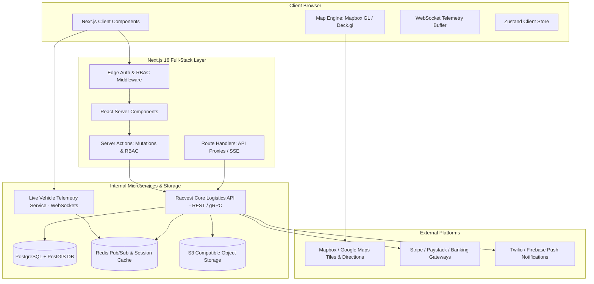
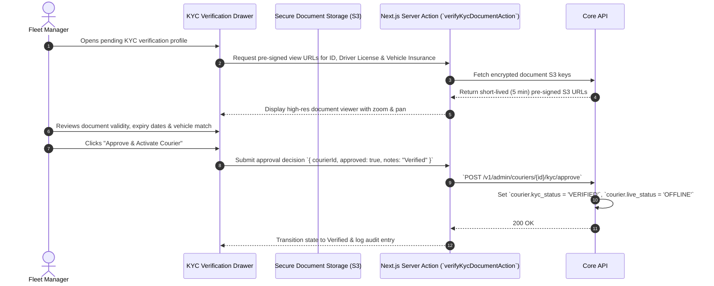
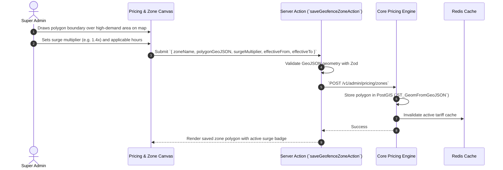

# Technical Architecture Document
## Racvest Admin Portal — On-Demand Courier Logistics Platform

**System:** Racvest Admin Web Application  
**Version:** 1.0.0  
**Framework:** Next.js 16.3+ (App Router) / React 19 / Tailwind CSS v4 / TypeScript 5  
**Maintained By:** Racvest Technology Engineering  

---

## 1. High-Level Architectural Blueprint

The Racvest Admin Portal is built as a modular, enterprise-grade Next.js App Router application designed to deliver real-time operational control, live mapping, and administrative oversight for courier deliveries.



---

## 2. Directory & Module Organization

The project follows a feature-driven, domain-driven structure within the Next.js App Router:

```
racvest-admin/
├── app/
│   ├── (auth)/                         # Unauthenticated routes
│   │   ├── login/                      # Admin login & MFA challenge
│   │   └── forgot-password/            # Password recovery flow
│   ├── (dashboard)/                    # Authenticated admin workspace
│   │   ├── layout.tsx                  # Persistent sidebar, header, global alert banner
│   │   ├── page.tsx                    # Executive summary & quick-action dashboard
│   │   ├── dispatch/                   # Live dispatch map & order orchestration
│   │   │   ├── page.tsx                # Real-time full-screen map & order queue
│   │   │   └── [orderId]/              # Granular order inspector & route replay
│   │   ├── couriers/                   # Fleet management & KYC
│   │   │   ├── page.tsx                # Courier directory, status filters, metrics
│   │   │   ├── [courierId]/            # Courier detail, vehicle, audit trail
│   │   │   └── verification/           # KYC review pipeline & document viewer
│   │   ├── shipments/                  # Orders & shipment ledger
│   │   │   ├── page.tsx                # Filterable order history & tracking
│   │   │   └── disputes/               # Claims, lost/damaged item disputes
│   │   ├── pricing/                    # Tariff & surge engine
│   │   │   ├── page.tsx                # Base rates, vehicle class multipliers
│   │   │   └── zones/                  # Polygonal geofence editor
│   │   ├── finance/                    # Earnings, payouts, invoices
│   │   │   ├── payouts/                # Rider batch payout approvals
│   │   │   └── cod/                    # Cash on delivery reconciliation
│   │   └── settings/                   # Platform configurations
│   │       ├── roles/                  # RBAC permissions manager
│   │       └── audit-logs/             # Tamper-evident admin action logs
│   ├── api/                            # Next.js Route Handlers (BFF / Webhooks)
│   │   ├── auth/                       # Session refresh, logout endpoints
│   │   ├── telemetry/                  # Polling fallback / snapshot endpoints
│   │   └── export/                     # CSV/Excel report streaming
│   ├── globals.css                     # Tailwind CSS v4 entrypoint & theme tokens
│   └── layout.tsx                      # Root layout (fonts, providers, metadata)
│
├── components/                         # UI Components
│   ├── ui/                             # Base atomic primitives (buttons, dialogs, inputs)
│   ├── layout/                         # Sidebar, TopNav, Breadcrumbs, Notifications
│   ├── maps/                           # Mapbox/Leaflet wrapper, driver markers, route polylines
│   └── domains/                        # Feature-specific composite widgets
│       ├── dispatch/                   # DispatchQueueCard, ReassignCourierModal
│       ├── couriers/                   # KYCApprovalDrawer, DocumentPreviewModal
│       ├── pricing/                    # GeofenceDrawingCanvas, SurgeRuleSlider
│       └── finance/                    # PayoutBatchTable, RefundApprovalDialog
│
├── hooks/                              # Custom React Hooks
│   ├── use-telemetry.ts                # WebSocket live courier coordinate stream
│   ├── use-rbac.ts                     # Current admin role permission evaluator
│   └── use-debounce.ts                 # Search and filter input debouncing
│
├── lib/                                # Core utilities and infrastructure clients
│   ├── api-client.ts                   # Fetch wrapper with auto-auth and error interceptors
│   ├── auth.ts                         # Server-side session verification & cookies
│   ├── permissions.ts                  # Role permission definitions & matrix
│   ├── geo.ts                          # Coordinates math, distance, bounding box calculations
│   └── utils.ts                        # Formatting (currency, date-fns, phone masking)
│
├── types/                              # TypeScript definitions
│   ├── courier.ts                      # Courier, Vehicle, KYC schemas
│   ├── shipment.ts                     # Shipment, Waypoint, PoD schemas
│   ├── pricing.ts                      # Tariff, Zone, Surge schemas
│   ├── finance.ts                      # Payout, Invoice, Ledger schemas
│   └── user.ts                         # AdminUser, Role, Permission schemas
│
├── public/                             # Static assets, vehicle SVG markers, logo
├── AGENTS.md                           # AI Agent guidelines & repo standards
├── ARCHITECTURE.md                     # This document
├── PRD.md                              # Product Requirements Document
├── SYSTEM_DESIGN.md                    # System Design Document
├── package.json                        # Dependency declarations & scripts
└── tsconfig.json                       # TypeScript compiler options
```

---

## 3. Technology Stack & Decision Matrix

| Layer | Technology | Rationale / Choice Justification |
| :--- | :--- | :--- |
| **Framework** | Next.js 16.3+ (App Router) | High-performance React framework with native Server Components, streaming SSR, built-in bundling optimizations, and robust API route handling. |
| **UI Library** | React 19 | Latest concurrent rendering features, native Actions support, optimized hooks, and fluid state transitions. |
| **Component Primitives** | shadcn/ui | Accessible, unstyled Radix primitives styled with Tailwind CSS v4 tokens, allowing full source code control and custom Racvest branding. |
| **Styling** | Tailwind CSS v4 | CSS-first configuration, ultra-fast compilation via Lightning CSS, custom Forest Green (`#0A3323`) palette and semantic alert tokens. |
| **Data Grid** | TanStack Table v8 | High-performance headless table engine powering the "Live Deliveries" grid with server-side pagination, multi-column filtering, and sorting. |
| **Data Visualizations** | Recharts (via shadcn/ui Charts) | Selected over Tremor due to seamless React 19 & Tailwind v4 support, granular custom tooltips, spline curves, and custom center-label donut charts. |
| **URL State Sync** | Nuqs | Type-safe URL search params adapter for Next.js App Router, enabling shareable and bookmarkable table filters, pagination, and date ranges. |
| **Type Safety & Schemas** | TypeScript 5 (Strict) + Zod | End-to-end type safety between API response schemas, form models, and UI props to prevent runtime regressions. |
| **State Management**| Zustand + TanStack Query | Zustand for lightweight client state (map bounds, selected pins, UI drawers); TanStack Query for server data caching, polling, and optimistic updates. |
| **Mapping Engine** | Mapbox GL JS / Deck.gl | WebGL-accelerated rendering capable of rendering thousands of concurrent moving vehicle pins with zero frame drops. |
| **Form & Validation**| React Hook Form + Zod | Minimal re-renders, accessible input states, and runtime schema validation for both client forms and server actions. |
| **Icons & Media** | Lucide React | Clean, tree-shakeable SVG icon library matching the Figma dashboard glyphs. |

---

## 4. Key Workflows & Execution Flows

### 4.1 Workflow 1: Live Parcel Tracking & Manual Courier Reassignment

When a courier experiences vehicle trouble or goes unresponsive, a dispatcher can manually reassign the shipment.

```mermaid
sequenceDiagram
    autonumber
    actor Dispatcher as Dispatch Operator
    participant UI as Dispatch Console (Client)
    participant Action as Next.js Server Action (`reassignCourierAction`)
    participant CoreAPI as Racvest Core Logistics API
    participant Notification as Push Notification Service
    participant Couriers as Courier Mobile Apps

    Dispatcher->>UI: Selects order from stranded/delayed queue
    UI->>UI: Highlights order pickup/dropoff & nearest idle couriers on map
    Dispatcher->>UI: Selects replacement courier & clicks "Confirm Reassignment"
    UI->>Action: Invokes action with `{ shipmentId, oldCourierId, newCourierId, reason }`
    Action->>Action: Validate session & check `DISPATCH_OVERRIDE` permission
    Action->>CoreAPI: `POST /v1/admin/shipments/{id}/reassign`
    CoreAPI->>CoreAPI: Update DB state & release old courier
    CoreAPI->>Notification: Trigger push alerts
    Notification->>Couriers: Send unassign alert to old courier; Send immediate task to new courier
    CoreAPI-->>Action: Return updated shipment snapshot
    Action-->>UI: Revalidation trigger & success toast
    UI->>UI: Update live order card & move pin connection polyline
```

### 4.2 Workflow 2: Courier KYC Verification & Approval



### 4.3 Workflow 3: Polygonal Geofence & Dynamic Surge Price Configuration



---

## 5. Security & RBAC Enforcement Pattern

### 5.1 Route & Middleware Guard Pattern
All requests to `/(dashboard)/*` pass through Next.js Middleware:
1. Verify session cookie integrity and expiration.
2. Check user's role against the route's required permissions.
3. Inject authenticated user context headers (`x-admin-id`, `x-admin-role`).

### 5.2 Server Action Defense Matrix
Every Server Action follows a standardized 4-step guard template:
```typescript
// Architectural Pattern for all Server Actions
export async function executeAdminAction<TInput, TOutput>(
  actionName: string,
  requiredPermission: Permission,
  input: TInput,
  handler: (admin: AuthenticatedAdmin, validatedInput: TInput) => Promise<TOutput>
): Promise<ActionResult<TOutput>> {
  // 1. Authenticate session
  const admin = await getAuthenticatedAdmin();
  if (!admin) return { success: false, error: 'Unauthorized' };

  // 2. Check granular RBAC permission
  if (!hasPermission(admin.role, requiredPermission)) {
    return { success: false, error: 'Forbidden: Insufficient Permissions' };
  }

  // 3. Execute business logic & mutations
  try {
    const result = await handler(admin, input);
    // 4. Record tamper-evident audit log
    await recordAuditLog({
      adminId: admin.id,
      action: actionName,
      details: { input },
    });
    return { success: true, data: result };
  } catch (err) {
    return { success: false, error: (err as Error).message };
  }
}
```

---

## 6. Coding Standards & Conventions

1. **Strict TypeScript:** No `any`. All API responses, forms, and component props must have explicit types or Zod inference schemas.
2. **Server-First Components:** Keep components as React Server Components by default. Add `'use client'` only to files requiring browser APIs, hooks, or event handlers.
3. **Path Aliasing:** Use `@/` for imports (`@/components/...`, `@/lib/...`, `@/hooks/...`, `@/types/...`).
4. **Resilient Error Boundaries:** Every domain section in `app/(dashboard)/` must include an `error.tsx` and `loading.tsx` to ensure isolated failure recovery.
5. **No Leaked PII:** Never output raw phone numbers, full residential coordinates, or customer banking details in client console logs or public state.
