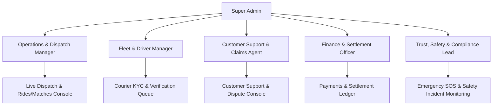
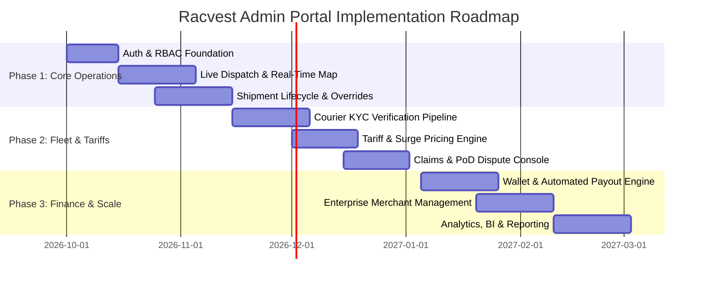

# Product Requirements Document (PRD)
## Racvest Admin Portal — On-Demand Courier Logistics Platform

**Document Version:** 1.0.0  
**Target Platform:** Web (Desktop & Tablet Optimized)  
**Status:** Approved / Draft for Implementation  
**Organization:** Racvest Technology  

---

## 1. Executive Summary

**Racvest** is an on-demand courier and package logistics platform ("Uber for sending items") that connects individuals and enterprise merchants with a vetted fleet of multi-modal couriers (motorcycles, bicycles, cars, vans, and freight trucks). 

The **Racvest Admin Portal** serves as the mission-critical operations control center. It empowers operational dispatchers, fleet managers, customer support agents, trust and safety officers, and financial controllers to monitor live deliveries, orchestrate fleet capacity, configure dynamic pricing, arbitrate disputes, audit financial settlements, and maintain regulatory compliance.

---

## 2. Problem Statement & Strategic Objectives

### 2.1 The Problem
On-demand parcel delivery requires instantaneous coordination between senders, couriers, and recipients. Without a centralized administrative operations suite:
- **Dispatch Bottlenecks:** Orders get stranded without automated matching or dispatcher intervention.
- **Rider Accountability & Fraud:** Risk of theft, parcel tampering, unauthorized route deviations, and unverified courier credentials.
- **Pricing & Capacity Inflexibility:** Inability to balance supply-demand shocks (e.g., peak rain, holiday rush, fuel price fluctuations).
- **Dispute Resolution Friction:** Disagreements regarding proof of delivery, item condition, or delayed delivery penalize customer trust.
- **Fragmented Financial Auditing:** High reconciliation complexity across rider payouts, gateway fees, merchant credit terms, and platform commission.

### 2.2 Core Objectives & Success Metrics
| Objective | Metric / Target |
| :--- | :--- |
| **Operational Efficiency** | Reduce Mean Time to Dispatch (MTTD) to < 45 seconds |
| **Delivery Reliability** | Maintain platform-wide On-Time Delivery Rate (OTDR) > 94% |
| **Courier Onboarding Speed** | Reduce KYC verification turnaround time from 48h to < 4h |
| **Safety & Dispute Settlement** | Resolve 95% of parcel damage/loss claims within 24 hours |
| **Financial Accuracy** | Zero discrepancy automated daily reconciliation across ledger and gateways |

---

## 3. Target User Personas & Permissions

The Admin Portal enforces strict Role-Based Access Control (RBAC):

1. **Super Admin:** Full platform ownership, role provisioning, configuration of global tariff parameters, system audit logs, and integration settings.
2. **Operations / Dispatch Controller:** Real-time visibility into all active orders, manual courier reassignment, route override, order cancellation, and rides & matches dispatching.
3. **Fleet & Courier Manager:** Vetting rider documentation (driver licenses, vehicle roadworthiness, criminal background checks), performance review, equipment issuance, and courier suspension.
4. **Customer Support & Claims Specialist:** Parcel tracking, customer/recipient inquiries, incident ticket triage, transit damage assessment, and courier/sender contact masking.
5. **Finance & Settlement Specialist:** Daily rider payout release, platform take-rate analysis, merchant invoice reconciliation, chargebacks, and refund processing.
6. **Trust, Safety & Compliance Officer:** Real-time **SOS emergency alerts** triage (immediate GPS panic-button escalation), fraud alerts (GPS spoofing, abnormal cancellations, suspicious parcel declarations), blacklisting, and regulatory compliance reporting.

---

## 4. Product Scope & Functional Requirements

### 4.1 Navigation Taxonomy & Dashboard Workspace
The Admin Portal navigation aligns with the unified operations taxonomy:
- **Top Navigation Bar:**
  - Racvest Brand Logo (Gold/Green icon).
  - Global Omnisearch (`"Search Anything"`) indexed by tracking ID (`RCV-XXXXX`), courier name, phone, or plate number.
  - Active Admin Profile badge & status menu.
- **Left Sidebar Navigation:**
  1. **Dashboard:** Primary operational command deck (KPI cards, alert tickers, trend analytics, live deliveries table).
  2. **User Management:** Sub-modules for Customers (Senders), Enterprise Merchants, and Couriers.
  3. **Deliveries:** Active, In-Transit, Picked Up, Pending, Delivered, and Cancelled shipment logs.
  4. **Rides & Matches:** Dispatch matching engine status, algorithmic batching, and manual courier assignments.
  5. **Payments:** Courier payouts, payment gateway transactions, platform commissions, Cash-on-Delivery (CoD) remittances.
  6. **Reports & Moderation:** Operational reports, user ratings moderation, courier dispute flags.
  7. **Customer Support:** Integrated ticketing console and inquiry management.
  8. **Analytics:** Revenue trends, delivery throughput, customer cohorts, geographic heatmaps.
  9. **Content Management:** Marketing banners, customer announcements, operational notices.
  10. **System:** External API configurations, webhook logs, database health monitoring.
  11. **Security:** Role-based access control (RBAC), multi-factor authentication (MFA), immutable audit logs.
  - **Footer Actions:** Settings (`/settings`) and Log Out (with red caution state).

### 4.2 Executive Dashboard & Live Operational Tickers
- **Tier 1 Hero Metrics:**
  - **Total Users:** Aggregate platform user count (e.g., `84,267`, `+8.4%` growth) displayed in a high-contrast Forest Green hero container.
  - **Active Deliveries:** Real-time count of shipments currently in transit or dispatched (`1,000`, `+12.4%`).
  - **Pending Verification:** Real-time courier KYC queue awaiting approval (`345`, `+12.4%`).
- **Tier 2 Urgent Operational Alert Tickers:**
  - ⚠️ **Open Disputes:** Active parcel damage/loss/delay disputes requiring human arbitration (`67`).
  - 🚨 **SOS Alerts:** Critical emergency panic button signals triggered by couriers or customers during active transit (`14`). Provides immediate location beacon, courier audio/route status, and emergency response dispatching.
  - 🎧 **Support Tickets:** Pending customer service inquiries (`44`).
- **Interactive Visualizations (Powered by Recharts):**
  - **Revenue Analytics:** 7-day spline curve showing daily revenue progression.
  - **Delivery Analytics:** 7-day volume trend comparing completed vs initiated shipments.
  - **User Growth:** Monthly bar chart (Jan–Dec) tracking new platform signups with tooltip markers (Total: `80,000`, `+12.4%`).
  - **Delivery Status Donut:** Central breakdown of current delivery distribution:
    - Delivered (`26.27%`), Picked Up (`52.84%`), In Transit (`13.26%`), Pending (`6.71%`), Cancelled (`1.72%`).

### 4.3 Live Deliveries Grid (Powered by TanStack Table & Nuqs)
- **Tracking ID Schema:** Standardized logistics tracking numbers using prefix `RCV-XXXXX` (e.g., `RCV-28142`).
- **Package Categorization:** Standard parcel types including *Clothing, Furniture, Sports Equipment, Beauty Products, Books, Groceries, Electronics, Documents*.
- **Routing Corridors:** Origin and Destination tracking (e.g., *Lagos $\rightarrow$ Lagos*, *Abuja $\rightarrow$ Ekiti*, *Osun $\rightarrow$ Abuja*, *Kano $\rightarrow$ Benin*, *Calabar*).
- **State Filter Pills & URL State Sync:** Status, Package Type, Date Range, Location, Destination synchronized via **Nuqs** to ensure shareable, bookmarked URL filters.
- **Table Columns:** Track No, Package Type, Sender (with avatar), Assigned Courier (with avatar), Origin, Destination, Status Badge, Last Updated latency, and "View" action button.

### 4.4 Live Dispatch & Order Orchestration
- **Live Real-Time Map:**
  - Interactive map displaying couriers (online, idle, busy, on-trip) and active delivery orders.
  - Heatmap overlay representing real-time order density vs. available courier supply.
- **Order Lifecycle States:**
  - `ORDER_CREATED` $\rightarrow$ `SEARCHING_RIDER` $\rightarrow$ `ASSIGNED` $\rightarrow$ `EN_ROUTE_PICKUP` $\rightarrow$ `ARRIVED_PICKUP` $\rightarrow$ `IN_TRANSIT` $\rightarrow$ `ARRIVED_DROPOFF` $\rightarrow$ `DELIVERED`.
  - Failure/Exception states: `FAILED_PICKUP`, `DELIVERY_FAILED`, `RETURNED_TO_SENDER`, `DISPUTED`, `CANCELLED`.
- **Manual Intervention & Overrides:**
  - Ability for dispatchers to manually force-assign an order to a specific courier or fleet partner.
  - Re-dispatch on courier breakdown or prolonged standstill.
  - Order cancellation with customizable fault attribution (sender fault, rider fault, platform error) and fee waivers.
- **Detailed Order Inspector:**
  - Waypoints (origin, multiple dropoffs if batch route), package photos, parcel weight/dimensions, fragile/perishable tags.
  - Recipient phone masking, delivery instructions, and declared package value.
  - Real-time telemetry: courier speed, heading, battery level, and estimated time of arrival (ETA).

### 4.2 Courier (Fleet) Management
- **Multi-Modal Fleet Profiles:**
  - Vehicle types: Bicycle, Motorcycle (standard & heavy cargo), Sedans, Vans, Light Trucks, Heavy Freight.
- **KYC & Verification Pipeline:**
  - Document ingestion: Government ID/Passport, Driver's License, Vehicle Registration, Insurance Policy, Background Clearance certificate.
  - Two-stage verification workflow (Document validation $\rightarrow$ In-person inspection/induction checklist).
  - Document expiry tracker with automated push notification triggers (30, 15, 7 days prior to expiry).
- **Courier Lifecycle & Performance:**
  - Activation, suspension, temporary probation, and termination.
  - Real-time stats: Acceptance rate, completion rate, customer rating (1-5 stars), cancellation rate, on-time delivery index.
  - Incident history (accidents, reported lost goods, police reports).

### 4.3 Customer & Enterprise Merchant Operations
- **Individual Senders:**
  - User profile, contact details, payment methods on file, delivery volume history, lifetime value (LTV).
- **Enterprise / B2B Merchants:**
  - Corporate accounts with multiple sub-users (e.g., e-commerce stores, restaurants, pharmacy chains).
  - Post-paid billing agreements, credit limits, contractual service level agreements (SLAs).
  - Dedicated API key management, webhook monitoring, and bulk shipment CSV upload audit.
- **Recipient Directory:**
  - Blacklist of known fraudulent addresses or high-risk recipient coordinates.

### 4.4 Pricing & Tariff Engine (Dynamic Fare Management)
- **Base Fare Rules:**
  - Per-vehicle pricing matrix: Base fare, per-kilometer rate, per-minute wait time rate, minimum order fare.
- **Weight & Dimension Surcharges:**
  - Volumetric weight calculation formula ($L \times W \times H / 5000$).
  - Overweight tiers (e.g., $>10\text{kg}$, $>25\text{kg}$, $>100\text{kg}$) and special handling fees (fragile, cold-chain, hazardous materials).
- **Geographic & Surge Pricing:**
  - Polygonal geofencing tool to define custom operational zones.
  - Zone-to-zone fixed pricing rules (corridors).
  - Dynamic surge multipliers based on live supply/demand ratio, bad weather conditions, or traffic congestion index.
- **Promotions & Vouchers:**
  - Campaign builder: discount percentages, capped values, minimum spend, expiry date, maximum total and per-user redemptions.

### 4.5 Package Safety, Security & Claims
- **Proof of Delivery (PoD) Audit:**
  - Secure recipient One-Time Password (OTP) verification logs.
  - High-resolution delivery photo verification (with GPS coordinates and timestamp watermarking).
  - Digital recipient signature capture.
- **Claims & Dispute Management:**
  - End-to-end claims ticketing system for lost, stolen, or damaged goods.
  - Investigation panel: Courier route replay (breadcrumbs), transit duration, communication logs between rider and customer.
  - Insurance payout approval workflow up to declared package value caps.

### 4.6 Financial Management & Wallet Settlement
- **Rider Earnings & Payout Ledger:**
  - Breakdown: Gross fare, platform commission (e.g., 15–25%), distance bonus, surge bonus, tips (100% to rider), toll reimbursements, penalties.
  - Automated weekly/instant payout batch generation with payment gateway payout routing (e.g., Stripe, Paystack, Flutterwave).
  - Manual hold on earnings for riders under dispute or fraud investigation.
- **Merchant Billing & Invoicing:**
  - Automatic tax invoice generation (VAT, sales tax compliance).
  - Payment collection tracking (Credit card, direct bank transfer, cash on delivery reconciliation).
- **Cash on Delivery (CoD) Audit:**
  - For parcels with CoD, tracking of cash held by couriers and mandatory remittance thresholds before accepting new orders.

### 4.7 Analytics, Reporting & Business Intelligence
- **Operational KPIs:** Live order velocity, dispatch acceptance latency, SLA breach alerts.
- **Supply & Demand Heatmaps:** Historical and predictive hourly distribution of courier utilization.
- **Financial Analytics:** Gross Merchandise Value (GMV), Net Take Rate, courier payout totals, refund ratios.
- **Data Export:** Granular CSV / Excel / Parquet scheduled exports for BI data warehouses.

---

## 5. Non-Functional Requirements (NFRs)

### 5.1 Performance & Latency
- **Map Telemetry:** Live courier positions updated at least every 3–5 seconds without UI stuttering (targeting $\ge 60$ FPS on modern desktop browsers).
- **Page Load:** Initial Dashboard load time $< 1.5$ seconds; client-side route transitions $< 200$ ms.
- **Search & Filtering:** Sub-second search indexing over hundreds of thousands of shipments and courier records.

### 5.2 Security & Compliance
- **Data Masking (PII Protection):** Sender and recipient phone numbers, full street addresses, and payment tokens must be masked based on agent privilege level.
- **Audit Trails:** Immutable, tamper-evident audit logging for all write operations (payout authorization, manual rider reassignment, pricing changes, KYC approvals).
- **Authentication:** Mandatory Multi-Factor Authentication (TOTP / Hardware key) for all admin roles; session timeout after 15 minutes of inactivity.
- **Data Protection:** Compliance with GDPR, NDPR, and PCI-DSS requirements.

### 5.3 Scalability & Reliability
- **System Availability:** 99.95% uptime SLA for administrative dispatch capabilities.
- **Graceful Degradation:** Automatic polling fallback if WebSocket connection to real-time telemetry service is severed.

---

## 6. Implementation Phasing & Milestones

- **Phase 1 (MVP — Dispatch Operations):** Authentication, Role permissions, Live Map with courier locations, Order detail inspector, Manual dispatch override, Basic courier list.
- **Phase 2 (Fleet Scaling & Tariff Management):** Full Courier KYC pipeline, Dynamic Pricing matrix, Geofenced zone configuration, PoD validation, Dispute ticketing.
- **Phase 3 (Enterprise & Financial Intelligence):** B2B Corporate invoicing, Automated payment gateway settlement, CoD remittance engine, Advanced predictive heatmaps and BI exports.
