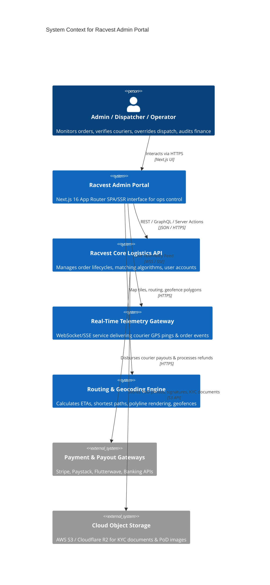
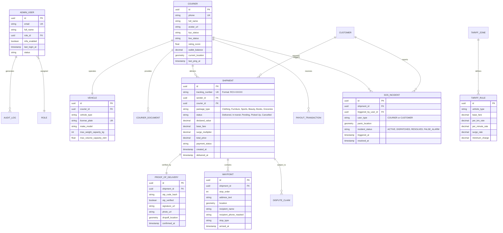
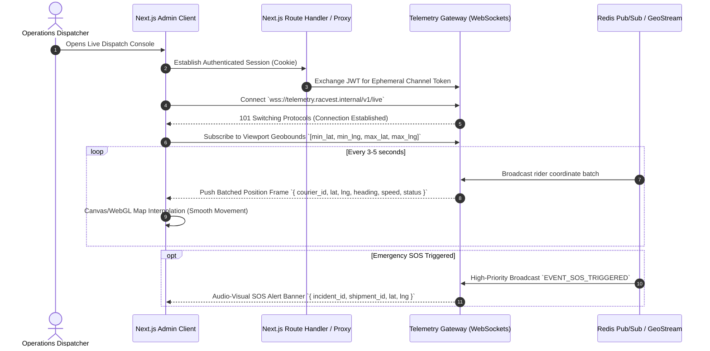
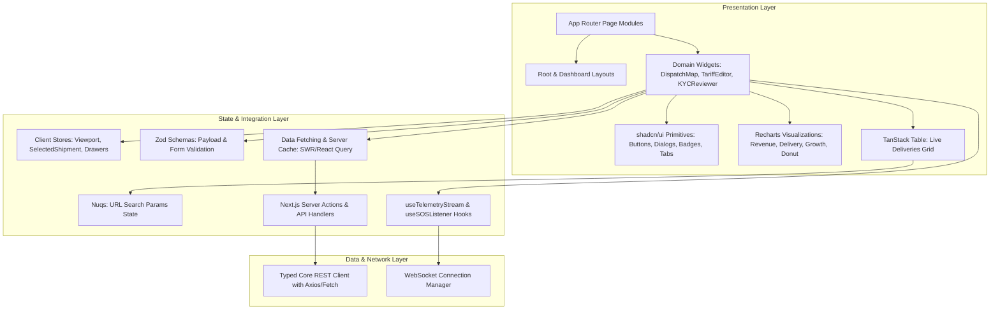

# System Design Document (SDD)
## Racvest Admin Portal — On-Demand Courier Logistics Platform

**System:** Racvest Admin Application  
**Version:** 1.0.0  
**Stack:** Next.js 16 (App Router), React 19, TypeScript, Tailwind CSS v4  
**Architect:** Racvest Technology Engineering  

---

## 1. System Overview & Context

The **Racvest Admin Portal** is the operational back-office web application for Racvest’s on-demand parcel and courier dispatch system. It provides high-concurrency real-time location tracking, fleet management, tariff calculation engines, parcel audit tools, and payment settlement workflows.

### 1.1 Context Diagram (C4 Level 1)



---

## 2. Core Entities & Data Architecture

The Admin Portal interacts with the core relational database (PostgreSQL with PostGIS extension for spatial queries).

### 2.1 Entity Relationship Diagram (ERD)



---

## 3. Real-Time Telemetry & Live Map Streaming

One of the most intensive features of the Racvest Admin Portal is real-time tracking of hundreds to thousands of concurrent couriers, active shipments, and instant SOS alerts.

### 3.1 Real-Time Streaming Architecture



### 3.2 GPS Drift Filtering & Coordinate Interpolation
- **Dead Reckoning & Slerp/Lerp:** To prevent jerky vehicle movements on the dispatcher's screen, the frontend map engine uses Linear Interpolation (`lerp`) across the last 2 timestamped coordinates, taking vehicle bearing into account.
- **Viewport Bounding Box Filtering:** Rather than subscribing to every driver nationwide, the client transmits its current map viewport coordinates (`bounds`). The gateway only streams events for drivers within or intersecting that spatial bounding box.
- **Heartbeat & Resilient Reconnection:** Exponential backoff with jitter (`1s`, `2s`, `4s`, up to `30s` max) if the WebSocket disconnects, seamlessly falling back to a 5-second polling route handler (`/api/dispatch/telemetry-snapshot`).

---

## 4. Frontend Application Architecture (Next.js 16 & React 19)

### 4.1 Rendering Strategy & Data Hydration
The application utilizes Next.js 16 App Router principles:
- **Server Components (RSC):** Default for static shells, metadata generation, authentication checks, initial table data hydration, and SEO/layout assembly.
- **Client Components (`'use client'`):** Reserved strictly for interactive UI boundaries:
  - Real-time map rendering (Mapbox GL JS / deck.gl).
  - High-frequency live filtering and search bars.
  - Interactive forms (Courier KYC review, Tariff slider configuration).
  - Real-time notification banners and WebSocket hooks.
  - Interactive data tables (TanStack Table) and dynamic charts (Recharts).
- **Server Actions & Zod:** Used for state-mutating actions (e.g., reassigning courier, issuing refund, approving KYC) with built-in CSRF prevention, strict Zod schema validation, and automatic cache revalidation (`revalidatePath`).
- **URL Query State (Nuqs):** Type-safe URL search params adapter syncing table pagination, active tab, date ranges (`7d`, `30d`), and filters (`status`, `packageType`, `location`).

### 4.2 Module & Component Layering


    TanStackQuery --> ServerActions
    ServerActions --> CoreClient
```

---

## 5. Security Architecture & Threat Modeling

Given the sensitivity of logistics data (customer home addresses, high-value cargo declarations, courier payouts), the Admin Portal adheres to defense-in-depth principles.

### 5.1 Authentication & Session Management
1. **Multi-Factor Authentication (MFA):** Mandatory TOTP (RFC 6238) for all administrative logins.
2. **Session Cookies:**
   - `HttpOnly`, `Secure`, `SameSite=Strict` cookie containing signed, short-lived session token (15-minute expiration).
   - Sliding session renewal with rolling refresh tokens stored in Redis with revocation capability.
3. **Role-Based Access Control (RBAC):**
   - Enforced at both Next.js edge middleware level and Server Action invocation level.

| Capability / Resource | Super Admin | Dispatcher | Fleet Mgr | Support | Finance | Safety |
| :--- | :---: | :---: | :---: | :---: | :---: | :---: |
| **Live Dispatch & Reassignment** | Full | Full | Read-Only | Read-Only | None | Read-Only |
| **Courier KYC Approval / Ban** | Full | None | Full | None | None | Full |
| **Tariff & Surge Pricing Config** | Full | Read-Only | None | None | None | None |
| **Issue Payouts & Adjustments** | Full | None | None | None | Full | None |
| **Unmask PII (Phone/Full Address)** | Full | Partial | Partial | Masked | None | Full |
| **View Audit Logs** | Full | None | None | None | Read-Only | Full |

### 5.2 PII Protection & Data Minimization
- Customer and recipient phone numbers are masked by default (`+1 (555) ***-8921`).
- Dispatchers and support agents click "Request Unmasking" which triggers a logged security audit event and provides temporary (3-minute) visibility for active delivery troubleshooting only.
- Strict Content Security Policy (CSP) blocking unauthorized script injection and frame embedding (`frame-ancestors 'none'`).

---

## 6. Performance, Scalability & Resilience

### 6.1 Bundle & Asset Optimization
- Map engine code (Mapbox/Leaflet) is dynamically imported (`next/dynamic` with `ssr: false`) to avoid server-side bundling overhead and reduce initial page JavaScript payloads.
- Font optimization using `next/font` for Geist and Inter.
- Real-time table virtualization (TanStack Table + Virtual) to render lists of 10,000+ orders without DOM thrashing.

### 6.2 Fault Tolerance & Circuit Breaking
- In the event of backend telemetry degradation, the frontend automatically switches from high-frequency WebSockets to delta-polling with progressive throttling.
- Network offline indicator alerts operators if their connection to the dispatch grid drops, queuing pending actions locally with confirmation prior to re-execution.
